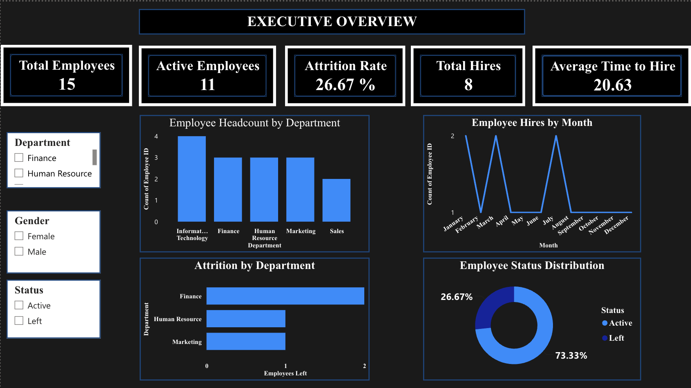
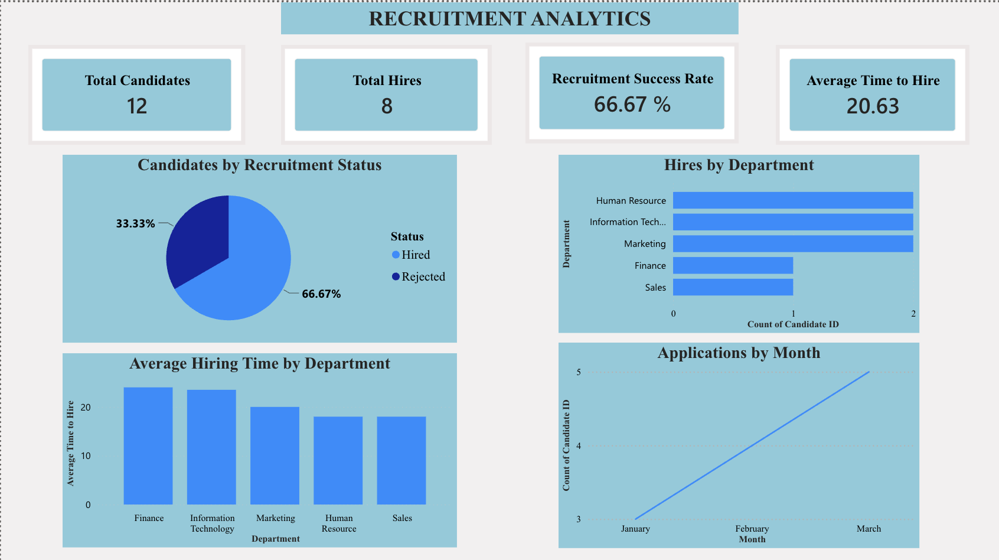
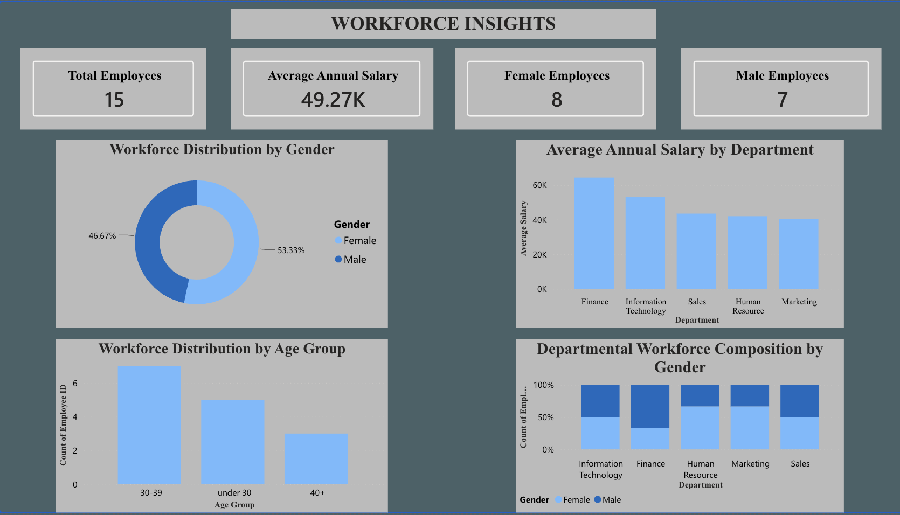

# People Analytics & Workforce Insights Dashboard (Power BI)



## Project Overview

This is the Power BI version of my HR analytics work. I took the same employee and recruitment data I used in my Excel dashboard and rebuilt it as a three-page interactive report, so I could see for myself how each tool handles the same questions. Excel got me to a working dashboard. Power BI let me go further: I cleaned the data in Power Query, wrote my own DAX measures, and split the story across three pages so HR leadership can move from the big picture to recruitment detail to workforce demographics.

After five years in HR operations across Nigeria and the UK, this is the kind of reporting I want to build for a team.

## Project Objectives

The objective of this project was to transform raw employee and recruitment data into actionable workforce insights, helping HR stakeholders understand employee demographics, workforce distribution, attrition patterns and recruitment performance.

## Business Questions

The report is built to answer these questions:

- How many employees does the company have?
- Which departments have the highest headcount?
- What is the attrition rate?
- Which departments are losing employees?
- How many candidates were hired?
- What is the average time to hire?
- What does the workforce look like by gender and department?

## Dashboard Pages

### 1. Executive Overview

KPI cards: **Total Employees**, **Active Employees**, **Attrition Rate**, **Total Hires** and **Average Time to Hire**.

Charts: **Employee Headcount by Department**, **Employee Hires by Month**, **Attrition by Department** and **Employee Status Distribution**.

Slicers: **Department**, **Gender** and **Status**.


**Business Purpose & Stakeholder Value**

The Executive Overview provides a snapshot of the organisation's workforce through key indicators such as total employees, active employees, employees who have left, attrition rate and average annual salary.

I selected these metrics to give stakeholders a quick understanding of the current workforce position and highlight important changes in employee numbers. Departmental and workforce distribution visuals provide additional context, helping management understand how employees are distributed across the organisation.

**Stakeholder Value:** This page helps HR teams and management monitor workforce size, understand employee retention patterns and identify areas that may require further attention. It provides a foundation for workforce planning and strategic HR decision-making.

### 2. Recruitment Analytics

KPI cards: **Total Candidates**, **Total Hires**, **Recruitment Success Rate** and **Average Time to Hire**.

Charts: **Candidates by Recruitment Status**, **Hires by Department**, **Average Hiring Time by Department** and **Applications by Month**.



**Business Purpose & Stakeholder Value**

The Recruitment Analytics page focuses on recruitment activity and hiring effectiveness using metrics such as total candidates, total hires, recruitment success rate and average time to hire.

I selected these metrics to evaluate how recruitment activity translates into successful hires and how long the hiring process takes. Application trends help stakeholders understand changes in candidate volume over time, while departmental comparisons provide insight into recruitment outcomes across different business areas.

**Stakeholder Value:** This page helps HR and recruitment teams monitor hiring performance, evaluate recruitment effectiveness, identify differences in departmental hiring outcomes and assess recruitment timelines. These insights can support improvements in recruitment planning and hiring processes.

### 3. Workforce Insights

KPI cards: **Total Employees**, **Average Annual Salary**, **Female Employees** and **Male Employees**.

Charts: **Workforce Distribution by Gender**, **Average Annual Salary by Department**, **Workforce Distribution by Age Group** and **Departmental Workforce Composition by Gender**.



**Business Purpose & Stakeholder Value**

The Workforce Insights page explores employee characteristics and workforce distribution through departmental headcount, employee demographics, salary patterns and attrition-related metrics.

I chose these dimensions to provide a deeper understanding of the organisation's workforce beyond the headline employee numbers. Departmental comparisons help identify differences in workforce distribution, while demographic and salary analysis provides additional context for understanding the employee population.

**Stakeholder Value:** This page helps HR teams and management understand workforce composition, identify departmental patterns and explore differences in employee demographics and salary distribution. These insights can inform workforce planning, employee retention discussions and future HR strategies.

## Data Preparation and Transformation

I loaded two sheets (Employees and Recruitment) from `PowerBI_HR_Data.xlsx` and prepared them in Power Query:

- Removed duplicate and blank rows
- Checked and set the data type of every column
- Replaced errors in the empty date fields with null
- Added **Time to Hire** (days between application and hire, for hired candidates only)
- Added **Application Month** from the application date
- Added **Age Group** (under 30, 30-39 and 40+) from employee age

## DAX Measures

| Measure | Definition |
|---|---|
| Total Employees | `COUNTROWS(Employees)` |
| Active Employees | `CALCULATE(COUNTROWS(Employees), Employees[Status] = "Active")` |
| Employees Left | `CALCULATE(COUNTROWS(Employees), Employees[Status] = "Left")` |
| Attrition Rate | `DIVIDE([Employees Left], [Total Employees], 0)` |
| Average Annual Salary | `AVERAGE(Employees[Salary])` |
| Total Candidates | `COUNTROWS(Recruitment)` |
| Total Hires | `CALCULATE(COUNTROWS(Recruitment), Recruitment[Status] = "Hired")` |
| Recruitment Success Rate | `DIVIDE([Total Hires], [Total Candidates], 0)` |
| Average Time to Hire | `AVERAGE(Recruitment[Time to Hire])` |

I used `DIVIDE` for the two rates so they never break when a slicer leaves nothing selected.

## Key Metrics and Findings

| Metric | Result |
|---|---|
| Total Employees | 15 |
| Active Employees | 11 |
| Attrition Rate | 26.67% |
| Total Candidates | 12 |
| Total Hires | 8 |
| Recruitment Success Rate | 66.67% |
| Average Time to Hire | 20.63 days |
| Average Annual Salary | 49.27K |

**Information Technology is the largest department** with 4 employees. Finance, Human Resource and Marketing have 3 each, and Sales has 2.

**Finance is losing the most people.** Two of its three employees have left (**Attrition by Department**), while Human Resource and Marketing each lost one. Information Technology and Sales lost none.

**Hiring takes about three weeks.** Finance is slowest at 24 days, followed by Information Technology at 23.5 and Marketing at 20, while Human Resource and Sales are fastest at 18 (**Average Hiring Time by Department**).

**Two thirds of candidates were hired.** 8 of 12 candidates were hired, with Human Resource, Information Technology and Marketing contributing 2 hires each and Finance and Sales 1 each (**Hires by Department**).

**Applications grew each month.** There were 3 applications in January, 4 in February and 5 in March 2024 (**Applications by Month**).

**Employee hires are spread across the year.** January, March and July are the busiest months for employee hire dates, with 2 each (**Employee Hires by Month**).

**The workforce is fairly balanced.** There are 8 female and 7 male employees (53.33% and 46.67%). By age, 7 employees are aged 30-39, 5 are under 30 and 3 are 40+. Finance has the highest share of male employees, while Human Resource and Marketing are two thirds female (**Departmental Workforce Composition by Gender**).

**Finance also has the highest average annual salary**, followed by Information Technology, with Marketing the lowest (**Average Annual Salary by Department**).

## Project Outcome

I developed a three-page interactive reporting solution that consolidates workforce and recruitment metrics into a single reporting experience, enabling HR stakeholders to explore employee demographics, attrition, salary distribution and recruitment performance.

## Tools and Technical Skills

- Power BI dashboard development
- Power Query and data transformation
- DAX measures and calculated columns
- KPI development
- Data visualisation and storytelling
- HR metrics and recruitment analytics

## Limitations and Dataset Disclaimer

The dataset is simulated and does not describe any real company or person. It is also small on purpose (15 employees and 12 candidates), so the findings show how the analysis works rather than real workforce patterns. The recruitment data only covers applications from January to March 2024, and the **Employee Hires by Month** chart groups employee hire dates by calendar month across all years.

## Repository Contents

```
README.md
PowerBI_HR_Data.xlsx
Screenshots/
    executive-overview.png
    recruitment-analytics.png
    workforce-insights.png
```

## Related Excel Project

The same data is also analysed in my [HR Recruitment & Workforce Analytics Dashboard (Excel)](https://github.com/Akambella/HR-Recruitment-Workforce-Analytics-Dashboard), if you would like to see how the two tools compare.

## About the Author

Built by Didi (Edidiong Akama), Berlin. MSc Information Technology Management student with a background in HR operations and workforce reporting.
